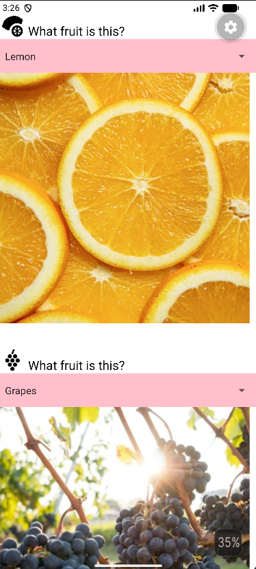
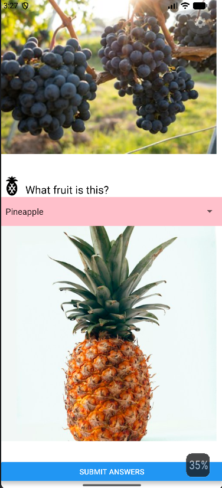
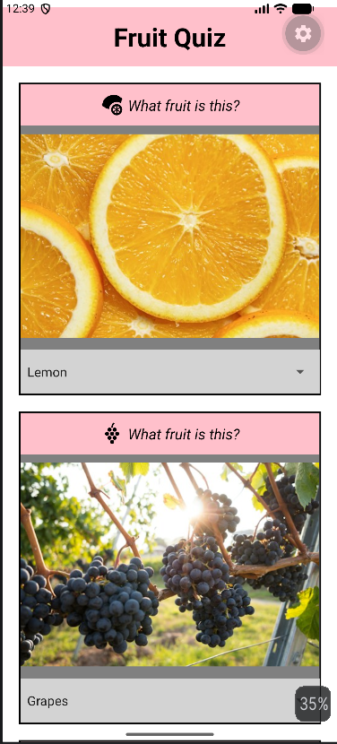
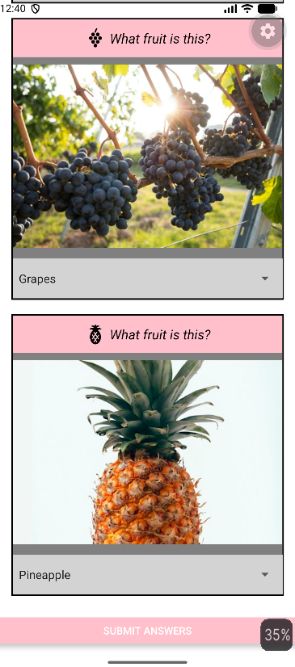

# App Name

Fruit Quiz is an interactive React Native mobile application designed to test users on their ability to identify different fruits through visual prompts. Users view images of various fruits, select their answers from interactive dropdown menus, and submit their choices to receive an instant score alert. 

# ScreenShots of App BEFORE applying Stylesheet changes

Screenshots:  
 

# ScreenShots of App AFTER applying Stylesheet changes

Screenshots:  
 
# Link to Demo Video with audible narration explaining styling changes with code reference

Demo Video Link:  
[Watch Fruit Quiz App Demo Video](https://drive.google.com/file/d/1XJNTSOG50JgD65AR3jb3Ipoj_n_BWmsb/view?usp=sharing)

